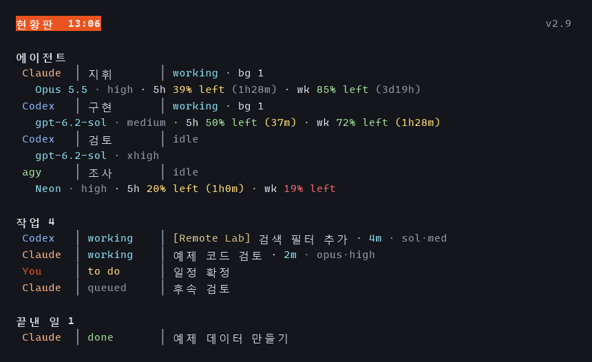

# Herdr Board · v2.11

A Windows terminal dashboard for running several AI coding agents (Claude Code, Codex, Antigravity `agy`) side by side in [Herdr](https://herdr.dev/). One glance shows who is doing what, how much quota each subscription has left, what is in progress, and what finished in the last 24 hours. A second view shows background jobs and their latest step. It makes **no model calls**: everything comes from the Herdr socket and local log files.

*Screenshot uses synthetic demo data (taken at v2.9; v2.11 keeps the same layout).*

## Why it exists

I run three agent platforms at once in one Windows terminal, split into separate **rooms** (one Herdr session per project). The agents hand work to each other through task cards. Three problems kept coming up:

- I could not tell at a glance which agent was busy, blocked waiting for input, or idle. That was worse across rooms.
- Quota is spread over three subscriptions with different 5-hour and weekly windows. Running out mid-task was the most expensive failure.
- A dashboard that asks a model to summarize its own state burns the quota it is supposed to protect.

The board answers those three questions without spending tokens and stays readable on a narrow pane next to the agents.

## What it shows

- **Agents**: role (lead, implementation, research…), live state (`working · 12m`, `input needed`, `idle`, `off`), model and effort, and the 5h and weekly quota with time to reset (`5h 86% left (4h29m) · wk 30% left (4d19h)`). Accounts shared by several sessions are shown once.
- **Work**: one list that merges running background jobs, backlog items, and the user's own to-dos, ordered by state. With `ShareRooms`, tasks from other rooms appear with a `[room]` tag. Since v2.11, so does a working or blocked **lead agent** in another room.
- **Done**: the last 24 hours, newest first.
- **Background view** (`bg-view.ps1`): running `codex exec`-style workers and their latest step, scoped to the current room.

### New in v2.11

- Other rooms' lead agents appear as `[room] lead · <current task>` rows.
- Rooms use their display label from the room definition, so non-ASCII names are supported.
- Two refresh tiers: agent state refreshes every 5 s. Expensive scans (worker logs, quota files, process lookups) are cached for 15–30 s.
- When a card has already reported completion but its backlog row still says `working`, the row shows *reported done · check* instead of a timer that keeps counting.
- An agent whose pane was recreated or closed shows as `off` instead of disappearing from the list.

## Run the demo

Use Windows PowerShell 5.1 or PowerShell 7 in a terminal with ANSI color support.

~~~powershell
.\board.ps1 -Demo
.\bg-view.ps1 -Demo
~~~

Add `-Once` for a single frame, or press Ctrl+C to stop the refreshing view. `-Refresh <s>` sets the fast tier (default 5) and `-SlowRefresh <s>` the cached tier (default 30).

## Use a live session

1. Start Herdr and copy `board.config.json` to `board.local.config.json`.
2. Run `herdr pane list` in the session and replace the example pane IDs in `Agents`. Each entry has a `Pane`, `Key` (platform), `Name`, and `Role`. Use `claude`, `codex`, or `agy` for `Key`. Multiple sessions can use the same platform.
3. Set the optional `Session` name or provide a socket through `HerdrSocketPath`. An existing `HERDR_SOCKET_PATH` takes precedence. File paths are relative to the configuration file and support `%ENV_VAR%` placeholders.

~~~powershell
.\board.ps1 -ConfigPath .\board.local.config.json
.\bg-view.ps1 -Session example-session -LogRoot .\logs\room
~~~

Each session should use its own `LogRoot` for the backlog and worker files. Pass the same root and session to both views. The sample uses `logs/room` for the named session and `logs` for shared files. Set `SharedLogRoot` in the board configuration and pass `-SharedLogRoot` to the background view if you move the shared root.

For a shared `exec-<id>.jsonl`, add `작업실: example-session` to the matching `card-<id>.md` in the same directory. The views can also use a worker's session or working directory, including the directory in a local Codex session record. To map project directories, set `Name` and an absolute `ProjectPath` in `spaces/<room>/effective-space.json`. That room's Herdr session name is `space-<room>`. Shared jobs without ownership information appear in the default Work session.

Run `./backlog.ps1 -LogRoot ./logs/room -Add "Check the sample" -Owner Codex -State working`, then `./backlog.ps1 -LogRoot ./logs/room -Done <id>` with the returned ID. Add `기기: Remote Lab` to a card to show a device tag.

Quota displays when compatible local captures are present. The included `claude-status.mjs` can be used as a Claude Code status-line command with Node.js. Its default output file is `logs/claude-usage.json`. Set `CLAUDE_STATUS_CAPTURE` to use another path and point `ClaudeUsageFile` there. `AgyUsageFile` accepts quota buckets with `remaining_fraction` and `reset_time`. `CodexSessionsPath` points to local Codex rollout files. Keep local configuration and runtime data private. Use `-Demo` when sharing a screenshot.

Run `.\verify-board-scope.ps1` for room isolation (81 checks) and `.\verify-board-matrix.ps1` for layout (144 frames). Both pass on Windows PowerShell 5.1 and PowerShell 7.

## How it was built: who did what

The board was built in three days (v2 → v2.11) inside the multi-agent setup it monitors. The person behind it did not write most of the code by hand. Their part was the parts agents cannot decide on their own.

| Decision | Who | What happened |
|---|---|---|
| **Problem and scope** | Human | Defined the three questions above. Required "token-zero": no model calls in the dashboard. |
| **Operating model** | Human | Split roles: Claude leads, reviews, and writes task cards; Codex implements and tests; `agy` researches and audits. Every card must state an end condition, a maximum number of round trips, and a deadline. |
| **UX direction, by feedback on real screens** | Human | Rejected a full rewrite (v3) and pinned v2's merged layout as the baseline, so later changes were small diffs on top of it. Asked to merge agents with quota, merge running work with to-dos, drop context-usage noise, show weekly reset time, fit the window height, and keep messages to two short lines. When the board grew cluttered: "it is too busy". This led to a calmer hierarchy. |
| **Generalization** | Human | Asked why one role was special-cased and why colors and roles were hard-coded, and pointed out that other projects would use it too. This led to configurable roles, platforms, and rooms. |
| **Safety and privacy boundaries** | Human | Agents may not commit, push, publish, log in, or move private data. A message from another agent is never treated as human approval. Publishing happens only on explicit human request, after a privacy scan, with synthetic demo data. |
| **Implementation** | Codex, Claude | Rendering, socket queries, log parsing, room scoping, PowerShell 5.1/7 compatibility, and regression suites. |
| **Research and audit** | agy | Compared about ten public multi-agent dashboards and orchestrators before publishing. Ran read-only consistency audits and finished v2.11 (caching, *reported done*, `off` state). |
| **Review and integration** | Claude | Reproduced bugs and checked the root cause before fixing. Ran both PowerShell editions. Kept a per-card lesson log. |

The working log produced **40 task cards** and **43 completed backlog items**. Each card left a lesson (what worked, what blocked, what to change), and those lessons became rules. Examples:
- Pin a UI the user liked before changing it.
- Queue a card by its path, not by pasting its body.
- Split work into cards that do not touch the same files, so agents can run in parallel.
- Never force-kill an agent's terminal.

## Techniques

- **Herdr socket CLI as the single source of truth**: `agent list` and `pane list` JSON for live state. Reading them costs about 0.1 s per frame. Agents are matched to roles through terminal and conversation identity, which survives pane moves and new conversations.
- **Flicker-free terminal rendering** with ANSI cursor control (`ESC[H` / `ESC[K` / `ESC[J`) instead of clearing the screen. Width calculation handles **CJK full-width text**, and lines are fitted without breaking escape sequences.
- **Quota without API calls**: parses Claude status-line captures, Codex rollout files, and agy quota buckets into a common `5h / weekly / reset` model.
- **Room isolation**: background jobs are assigned to rooms using card tags, working directories, and Codex session records. This is verified by an 81-case scope suite.
- **Windows PowerShell 5.1 and PowerShell 7 from the same source**. Avoids APIs that exist only in .NET Core. Files with non-ASCII text have a BOM. Shared-read file access avoids lock conflicts with writers.
- **Tiered refresh and caching**: cheap socket state refreshes every frame, and expensive file and process scans run on a slower cadence.
- **Regression-first changes**: a 144-frame layout matrix and scope, relay, and backlog suites run before each release.

## 한국어

Claude Code·Codex·Antigravity(agy)를 Herdr 한 터미널에서 함께 돌릴 때 쓰는 현황판입니다. 모델을 호출하지 않고(토큰 0), 다음을 한눈에 보여 줍니다.
- 에이전트별 역할·상태·모델
- 구독 3개의 5시간·주간 남은 사용량과 초기화까지 남은 시간
- 진행 중인 작업과 최근 24시간 동안 끝낸 일
- 다른 작업실의 작업과 지휘 상태

**사람이 맡은 부분**
- 문제 정의와 "토큰 0" 원칙
- 지휘·구현·조사 역할 분담, 카드마다 끝 조건·최대 왕복·마감을 두는 협업 방식
- 실제 화면을 보고 내린 UX 판단: 마음에 든 v2를 기준본으로 고정, 번잡함 제거, 주간 초기화 시간 표시
- 다른 프로젝트에도 쓸 수 있게 일반화하라는 요구
- 커밋·공개·로그인·개인정보 이동은 사람만 승인한다는 안전 경계

**AI 에이전트가 맡은 부분**
- 구현(Codex·Claude), 조사·감사(agy), 재현·검토·통합(Claude)

사흘 동안 카드 40개를 처리했습니다. 카드마다 교훈을 남겨 규칙으로 쌓았습니다.

**주요 기술**
- Herdr 소켓 JSON 기반 상태 수집
- ANSI 커서 제어로 깜박임 없는 화면, 한글 전각 폭 계산
- API 호출 없는 사용량 파싱
- 작업실별 작업 분리
- PowerShell 5.1과 7 동시 지원
- 2단 갱신 캐시
- 회귀 시험(화면 144가지 조합, 작업실 분리 81건)

[MIT License](LICENSE)
